# MiniHouse · Promotional website · Task plan R1

**Revision R1, 2026-11-17.** Replaces Antigravity's plan v1 from the same day ([archived copy](plan-v1-antigravity.md)). Role: frontend-designer, using the [project frontend skill](../../../../.agents/skills/minihouse-frontend-design/SKILL.md). **Status: plan awaiting Carlos's approval. Nothing in it has been built, generated or deployed yet.**

Carlos's brief:

- Build the website that **promotes** MiniHouse, the way [the MAYA listing on FINN](https://www.finn.no/recommerce/forsale/item/417043406?ci=3) promotes its house. Show **our house from [images/](../../../../images/)**, not MAYA.
- Create a **modern retro Norwegian** look built around **old, renewable timber** and sustainability.
- Run the work as a real **design thinking** process.
- Use **copper** and natural wood colours: **malmfuru** (heartwood pine) and **eik** (European oak).

> **Change R1.2, 2026-11-17: MiniHouse is not for sale and is not presented as an emergency cabin** (decisions D10 and D11). Carlos: «we are not going to sell it or show us emergency cabin just like Minihouses». This overrides every part of the plan below that assumes a sale:
>
> - **"Buyer"** now means a visitor interested in minihouses: homeowners with a plot, cabin owners, curious people. The emergency-housing persona (§1, audience 2) is dropped.
> - **No sale.** No price, no «Pris kommer», no ordering and no sales wording. The FINN listing remains a model for *presenting* a house (pictures first, key facts), not for selling one, and the FINN ad kit (6.6) is cancelled.
> - **The call to action is «Følg prosjektet»** (D1). Visitors leave an e-mail address to get project updates, and success reads «Takk! Du følger nå prosjektet.» Wherever the plan says «Meld interesse», read «Følg prosjektet».
> - **The hero title is «Et lite hus, laget for å flyttes.»** (D12), in English "A small house, made to be moved."
> - **The FAQ** answers what visitors wonder about minihouses, without offering a service.

**Who does what:** [agents/README.md](../../agents/README.md) splits this plan between Antigravity, Cursor and DeepSeek, and every agent follows [DESIGN-GUIDE.md](../../DESIGN-GUIDE.md). Each task names an output file. When agents run at the same time, they work on different files ([rules.md](../../../../rules.md)).

---

## 0. Review of plan v1: what went wrong, and what R1 does instead

| # | Plan v1 | Problem | R1 |
|---|---|---|---|
| 1 | "Generate clean, UI-free 4K photos" of the exterior | Antigravity's earlier renders show a **flat-roofed steel container on stilts**, not Carlos's gable-roofed timber house. One of them is **live now** as `concepts/hero-nordic.jpg`, with "Structural integrity: verified" and "U-0.15 W/m²K" baked into the picture. Nothing in v1 stops this from happening again. | §2 locks a **canonical house** based on `images/`. Every new image must pass a fidelity checklist. Stage 0 removes the container renders from the live site. |
| 2 | Calls the 4 bathroom images "architectural photos" | They are AI renders of a house that has not been built. Calling them photos on a sales page misleads buyers. | Every image is captioned *Konseptbilde* (concept image). A status line says the house is still in development. |
| 3 | Spec table: S355 bolted steel, triple glazing, recycled insulation, composting/Cinderella/flush toilets, "crane-ready skid" | None of these are in the project's data, and rules.md allows no value without a source. Several conflict with open items: C-01 (use class), C-08 (timber) and the 4.00 m transport-height problem. | A **claims register** (§12) decides what the site may say. Anything without a source is not published. |
| 4 | "Provenance of reclaimed Malmfuru" and "Eik sill joinery" stated as facts | The species and source of the reclaimed timber are still open (C-08). By default the project uses reclaimed timber for cladding and finishes, not structure ([module brief §3](../../../../knowledge/comparisons/module-brief.md)). | Malmfuru and eik set the design direction and the colours. The copy says "planned" until the timber lot is documented. Oak goes into the structure only if the engineer confirms it. |
| 5 | "Genuinely sustainable", "zero toxic …" | These are vague environmental claims. Norwegian consumer guidance expects green claims to be specific and documented. | Only specific, documented claims, such as "the cladding is reclaimed timber from …". Stage 5 checks every claim against Forbrukertilsynet's guidance. |
| 6 | "Design thinking" exists only as five headings | There is no research with people, no problem statement and only one design direction. "Test" means lint, build and deploy. | Every stage has real activities: 5 buyer interviews, 3 design directions, a moderated usability test, an iteration loop and 5 approval gates. |
| 7 | Cream `#F5EFE6`, Fraunces, copper, JetBrains Mono labels, 10 colours | This is the most common AI-generated look: cream ground, soft serif, clay accent, mono labels. "Modern retro" is never defined, and no colour has a set job. Cream text on v1's copper button measures **4.20:1** and copper text on cream **3.95:1**. Both fail AA, although v1 says they pass. | The "Patina" system (§8) has 6 colours sampled from Carlos's images, each with one job, and a wood-type Clarendon display face. "Retro" is defined as 1950s–70s Norwegian craft. Every text pair measures ≥ 4.5:1. |
| 8 | Builds the promo page inside `web/chat-demo` (React SPA bundling Mermaid, KaTeX and Prism) | That is a heavy, client-rendered page for people opening a link from FINN on their phone. Link previews and SEO are weak, and the promo page is tangled up with the engineering lab. | A separate static **Astro** site in `web/promo/`, the stack the project skill already names. The chat and 3D lab move to their own address. |
| 9 | AI concierge with buyer prompts on the landing page | The chat needs each visitor's **own OpenRouter key** ([despliegue-web.md](../../../../docs/despliegue-web.md)), and buyers won't have one. Free LLM answers about cranes and windows would also invent engineering claims. | Not part of the MVP. The FAQ is written from the claims register. An assistant can return later (P2), answering only from that FAQ and running on a server-side key. |
| 10 | Section 3 is a 3D chassis explorer; specs and contact come last | The page leads with engineering again, while a FINN listing leads with pictures, price, key facts and contact. | The page order follows Carlos's concept mockups and the FINN layout (§8.6): gallery and key facts first, then the house, materials, moving, status and FAQ, and the interest form. |
| 11 | `canner redeploy --follow` | [despliegue-web.md](../../../../docs/despliegue-web.md) says never to use `canner redeploy`, because it rebuilds the monorepo. The live content is a CLI upload of `dist/`. | Stage 6 uses the documented upload command with the system Node. |
| 12 | "Commit and push to main" | About 60 files from other agents are uncommitted in the working tree, so a blanket commit would ship their unfinished work. The Canner project is also still connected to GitHub. | Use a branch that holds only the promo files, and commit or push only when Carlos says so. Check Canner's auto-deploy setting before anything reaches main. |
| 13 | Delete `public/concepts/` | rules.md says to keep originals. | Archive the files first, then remove them from the production build. |
| 14 | Crop "clean regions" out of the mockups | The hero crop is about 1015 × 575 px and the detail crops about 450 × 230 px, too small for a hero or for retina screens. | Re-render clean versions with the canonical prompt (§2.3). Use crops only as stand-ins in wireframes. |
| 15 | Bathroom renders shown as *the* bathroom | R0 puts the bathroom in a strip about 1.2 m deep at one end (S-04), but the renders show a deeper room. | Check the renders against the R1 plan. If they don't fit, caption them as *materialstemning* (material mood), not as the layout. |
| 16 | English `[CONCEPTUAL]` badges, English copy first | Engineering jargon aimed at Bergen buyers. | Norwegian Bokmål first, English second, with plain-language captions. |

---

## 1. Brief

- **Subject.** MiniHouse: a house of about 6 × 3 m with a steel base, reclaimed timber and a gable roof. It is designed in Bergen to be moved in one piece by truck and crane.
- **Main job of the site.** Make a buyer in Bergen or Western Norway want the house, tell them honestly where it stands, and get them to press **Meld interesse** (register interest).
- **Audience** (hypotheses, tested in Stage 1):
  1. A homeowner who has a plot and needs an extra unit: an annex, a rental flat, a guest house or a home office.
  2. Someone who needs a place to live quickly. This is the "emergency cabin" use Carlos named; its legal class is still open (C-01).
  3. A cabin owner who wants a second small building.
  4. Secondary: builders, crane and transport firms, municipalities and partners. They are sent to the documentation site.
- **What we borrow from the FINN listing:** the order of information only, not its look, text or photos (Appendix A).
- **The house we show:** only the one in `images/` (§2).
- **Languages:** Norwegian Bokmål as the default (`/`) and English (`/en/`). A native speaker reviews the copy.
- **Not in the MVP:** AI chat on the landing page, the 3D lab, a configurator, undecided prices, payments.

---

## 2. The canonical house (image fidelity)

### 2.1 What every image of MiniHouse must show

This is taken from Carlos's six exterior and interior concepts.

- One storey, a long rectangle roughly 2:1 in plan.
- A symmetrical gable roof in black standing-seam metal, with slim eaves.
- Vertical reclaimed boards with natural variation. The weathered silver-brown of the *slope* and *meadow* images is the reference tone.
- On the long façade: a solid black door left of centre and one large black-framed picture window. A small black-framed window on the gable end.
- A dark steel base that reads as a thin plinth. No exposed steel frame on the walls, no container corner castings, no stilts, no wheels.
- Setting: Western Norway, with fjord, birch, rock and heather under soft overcast light.
- Interior: pale pine panelled walls, a built-in bench with storage, a small kitchen with green fronts and a fold-down table. The bathroom has petrol-green glazed tile, a wavy copper mirror, a reclaimed-timber vanity and an oak window frame.

### 2.2 Inconsistencies Carlos must settle before new renders

| Item | Variants in the concepts | Default if there is no answer |
|---|---|---|
| Door | solid black (5 images) / glazed (*workshop* image) | solid black |
| Base | plinth flush with the ground (*meadow*, *mobile*) / short steel legs (*slope*) | slim plinth on low supports |
| Cladding tone | silver-brown (*slope*, *meadow*) / dark brown (*workshop*) | silver-brown |
| Openings | images vs the R0 plan, which puts V-02 and V-03 on the back façade | follow the images, captioned as concept. No dimensions are taken from images ([registro F](../../../../fase1/registro-decisiones.md)) |
| Bathroom size | renders show a deeper room than R0's 1.2 m strip | caption as material mood until the R1 plan confirms the size |

### 2.3 Canonical prompt for clean re-renders

Carlos made the originals in ChatGPT, so the most faithful clean versions come from the same tool, ideally in the same conversation.

> Photorealistic architectural photograph. No text, no website interface, no logos, no watermark. A small single-storey house about 6 m long and 3 m wide with a symmetrical gable roof in black standing-seam metal. Walls of vertical reclaimed timber boards, weathered silver-brown with natural variation. On the long façade: a solid black door left of centre and one large black-framed picture window; a small black-framed window on the gable end. A slim dark steel base. Setting: grassy slope above a fjord in Western Norway, birch trees, mossy rocks, soft overcast daylight. Eye-level three-quarter view. Landscape 3:2, at least 2400 px wide.
> Do not draw: a shipping container, a flat roof, a steel frame around the walls, stilts, wheels.

Scene variants:

- **(a)** Hero: the house on the fjord slope.
- **(b)** Meadow wide shot, 16:9.
- **(c)** Exploded view (base, walls, roof) on a plain studio background.
- **(d)** Living room and kitchen in autumn light.
- **(e)** Workshop, with the finished house on the floor.
- **(f)** The house on a low flatbed truck in a wet yard.
- **(g)** The house set on its supports on a rocky plot.
- **(h)** Close-up textures: malmfuru board face and end grain, oak sill, a copper fitting with patina, a standing-seam detail.

### 2.4 Fidelity checklist

Run this for each image and record the result as a row in `fase4/promo/bildeliste.csv`.

- [ ] Roof form matches §2.1
- [ ] Cladding direction and tone match
- [ ] Door and window arrangement matches
- [ ] Base matches; nothing that looks like a container
- [ ] No text, UI or watermark
- [ ] Resolution: at least 2400 px for the hero, 1600 px for sections
- [ ] Caption and alt text written in Norwegian and English
- [ ] Approved by Carlos

### 2.5 Rejected images

Never publish these: `web/chat-demo/public/concepts/*.jpg` and Antigravity's `hero_*`, `detail_*`, `exploded_*` and `minihouse_*` renders. They show a flat-roofed container on stilts with a fake browser frame, and false claims are baked into the pictures. Archive them in `fase4/promo/archive/rejected-renders/` with a README that says why.

---

## 3. Process at a glance

```mermaid
flowchart LR
  S0["0 · Reset<br/>pull false images, archive, freeze claims"] --> E
  E["1 · Empathize<br/>Carlos, 5 buyers, market scan"] --> D
  D["2 · Define<br/>POV, HMW, claims register, metrics"] --> G2{{"G2 · Carlos approves brief"}}
  G2 --> I["3 · Ideate<br/>3 directions, sketches, card sort"]
  I --> G3{{"G3 · Direction chosen"}}
  G3 --> P["4 · Prototype<br/>wireframes, copy, images, Astro build"]
  P --> G4{{"G4 · Content and images approved"}}
  G4 --> T["5 · Test<br/>5 users, accessibility, performance, claims"]
  T -- "findings" --> P
  T --> G5{{"G5 · Carlos approves launch"}}
  G5 --> L["6 · Launch<br/>deploy, verify, FINN kit"]
```



The work passes 5 gates: **G1** Stage 0 done, **G2** brief, **G3** design direction, **G4** content and images, **G5** launch. At each gate, Carlos's answer is recorded with its date in `fase4/promo/decisions.md`.

---

## 4. Stage 0 · Reset (do first)

| ID | Task | Output | Done when |
|---|---|---|---|
| 0.1 | Remove the three container renders from the live site. Rebuild `web/chat-demo` without the `concepts/` images, using either a clean image from `images/` or no image, and redeploy as described in [despliegue-web.md](../../../../docs/despliegue-web.md). **This changes a public site, so it needs Carlos's OK.** | live site | `https://minihouse.canner.app/concepts/hero-nordic.jpg` returns 404 and no container house is visible |
| 0.2 | Archive the rejected renders together with a README that gives the reason | `archive/rejected-renders/` | files and reason recorded |
| 0.3 | Create the claims register from §12 | `02-define/claims-register.csv` | every claim has a status and a source |
| 0.4 | Write the canonical house spec (§2), with Carlos's answers to §2.2 or the defaults | `canonical-house.md` | **G1** |

---

## 5. Stage 1 · Empathize

| ID | Task | How | Output | Done when |
|---|---|---|---|---|
| 1.1 | Interview Carlos as the owner | 45 minutes on: why promote now, who he pictures living in the house, what "emergency cabin" means in practice, build budget and price ambition, timeline, and what "modern retro" means to him (sort 15 references into like and dislike). Also his must-haves and things he never wants. | `01-empathize/carlos-interview.md` | goals, constraints and taste recorded in his own words |
| 1.2 | Market scan | Look at 10 Nordic minihus listings and builder sites (FINN-torget and builders): what they show first, whether they show a price, which photo types they use, trust signals, and how they handle permits, transport and delivery. Record structure only, without copying text or images. | `01-empathize/market-scan.md` | patterns, plus gaps MiniHouse can own (for example, nobody documents where reclaimed wood comes from) |
| 1.3 | Recruit 5 people who match the personas | Carlos's network, Bergen groups about annexes and minihus, colleagues. 30 minutes each. | recruiting list kept **outside the repo** | 5 sessions booked |
| 1.4 | Interviews | Ask about the last time they looked at a minihus or annex, what made them trust or leave, what *gjenbrukt tre* (reclaimed wood) means to them (charm or quality risk), their fears (damp, rot, building permits, transport, price) and what would make them get in touch. | `01-empathize/interviews/P1…P5.md`, anonymised with initials | 5 sets of notes |
| 1.5 | Empathy map and journey map | Synthesise 1.1–1.4. The journey runs from FINN or Google to the site, the pictures, "can I put this on my plot?", the price and finally contact. | `01-empathize/synthesis.md` | top 5 needs and top 5 fears, ranked by how often they came up |

---

## 6. Stage 2 · Define

| ID | Task | Output | Done when |
|---|---|---|---|
| 2.1 | Point-of-view statement and How-might-we questions | `02-define/pov-hmw.md` | Carlos agrees the POV describes the buyer |
| 2.2 | Value proposition and message order: one sentence, three proofs, one call to action | `02-define/messaging.md` | fits both a FINN title and the hero |
| 2.3 | Complete the claims register with everything the interviews asked about | `02-define/claims-register.csv` | no sentence in the copy deck lacks a row |
| 2.4 | Success measures | `02-define/metrics.md` | targets agreed |
| 2.5 | Sitemap and content model, including which concept image feeds each section | `02-define/sitemap.md` | matches §8.6, or the changes are recorded |
| G2 | **Carlos approves the brief:** audience, pages, content, media, languages, call to action and how the price is shown | `decisions.md` | closes the first Fase 4 box in [PROJECT.md](../../../../PROJECT.md) |

Starting drafts, to be rewritten from the research:

- **POV:** A Bergen homeowner who needs a small extra home quickly needs to see that a movable house can be warm, solid and honestly built from old timber, because they fear damp, rot, permit trouble and hidden costs.
- **HMW:**
  - How might we show old timber as a quality rather than a compromise?
  - How might we be honest that MiniHouse is still a concept and still make people want it?
  - How might we make "moved in one piece by crane" easy to picture?
  - How might we answer "can I put it on my plot?" without making legal promises?
- **Metrics:**
  - Interest registrations per 100 visitors.
  - The share of visitors who open the gallery.
  - In tests, 4 of 5 people can say within 60 seconds what MiniHouse is, what it is made of, that it isn't built yet and how to get in touch.

---

## 7. Stage 3 · Ideate

| ID | Task | Output | Done when |
|---|---|---|---|
| 3.1 | Moodboard of modern retro Norwegian references, drawn from the five sources below | `03-ideate/moodboard.md`: links and the reason for each. Licensed images stay internal. | 20–30 references |
| 3.2 | Three style directions, each shown as a one-page style tile with the same hero and one material block:<br>**A · Patina** (recommended, §8)<br>**B · Hytte '74:** pine panelling, rya orange and brown, a Cooper-style soft serif such as Caprasimo. Warmer and more nostalgic.<br>**C · Stavkirke:** tar-black ground, a carved high-contrast serif, glints of copper. Darker and more dramatic. | `03-ideate/style-tiles/` | all three rendered at 360 and 1280 px |
| 3.3 | Crazy 8s sketching on the hero and the materials block, with Carlos and the agent | photos of the sketches | ≥ 16 ideas |
| 3.4 | Open card sort with 3 of the interviewees | `03-ideate/card-sort.md` | section names that users understand |
| 3.5 | Shot list: which images exist, which need re-rendering, and which can be real photos of Carlos's actual reclaimed boards (the strongest proof of the old-wood story) | `03-ideate/shot-list.md` | every section has an image source |
| G3 | **Choose a direction.** Run a 5-second test and a preference test of A, B and C with 5 people, then Carlos decides | `decisions.md` | one direction chosen, with notes on what to borrow from the others |

What "modern retro Norwegian" draws on in this project:

1. **1970s cabin interiors:** honey-coloured pine panelling, rya rugs, brown, orange and green.
2. **1960s Norwegian enamel and ceramics** (Cathrineholm, Figgjo): flat, bold colour on pale enamel. The bathroom's orange mirror and green glaze belong to this world.
3. **Stave churches and log building (laft):** malmfuru, tar and carved portals, old wood that has lasted for centuries. For example, Urnes stave church, about 1130; cite a source before publishing.
4. **Type:** 19th-century wood type and its 1950s Clarendon revival.
5. **The modern part:** Carlos's own concepts, with large photography, calm grids and short copy.

---

## 8. Visual system "Patina" (direction A, recommended)

**The idea: materials that get better with age.** Old malmfuru weathers to silver, oak darkens and copper turns green. The word *patina* ties old wood, retro and sustainability together, and every colour on the page is a material of the house.

### 8.1 Colour: 6 core tokens sampled from Carlos's images

The base values are medians of pixel regions in `images/`, then adjusted for daylight and contrast. The method goes into `web/promo/src/styles/tokens.md` when the site is built.

| Token | Hex | Sampled from | Job |
|---|---|---|---|
| `--kalk` | `#ECEAE4` | the lime-plaster bathroom walls, corrected to daylight | page ground: chalky, not cream |
| `--tjaere` | `#241A13` | the tar-black of stave churches (the steel base samples at `#222220`) | text and the footer band |
| `--malmfuru` | `#9D5F30` | the reclaimed-timber vanity (median) | large wood surfaces, swatches, display type ≥ 24 px only |
| `--eik` | `#BA936B` | the oak window frame (median) | key-facts band and spec table, like a workbench |
| `--kobber` | `#A9481C` | between the copper mirror `#BF4002` and aged copper `#A74925` | everything interactive, and nothing else |
| `--irr` | `#2C4F40` | the petrol-green glazed tile (upper quartile) | interior and bathroom band (*irr* is Norwegian for verdigris) |

Support colours:

- `--kobber-lys` `#E08A52`: copper on dark bands.
- `--solvgra` `#8C7E71`: weathered cladding, used for hairlines and borders.
- `--malmfuru-mork` `#6F3F1E`: wood-toned text on `--kalk`.

Measured contrast (WCAG 2.x):

| Pair | Ratio | Allowed use |
|---|---|---|
| tjære on kalk | 14.17 | body text |
| kobber on kalk, and kalk on kobber | 4.81 | links and buttons |
| kalk on irr | 7.59 | text on the interior band |
| tjære on eik | 6.07 | spec table |
| kobber-lys on tjære | 6.43 | links in the footer |
| malmfuru-mørk on kalk | 7.26 | wood-toned headings |
| kalk on malmfuru | 4.24 | large type only (≥ 24 px) |
| sølvgrå on kalk | 3.27 | borders and dividers only |
| kobber-lys on irr | 3.45 | focus ring and icons only, never text |
| kobber on eik | 2.06 | **never** |

Rules:

- Copper only on things you can press: links, buttons, focus, the active tab and lightbox controls. In the house, the copper is the fittings.
- No gradients, and no drop shadows except on the lightbox.
- One 2 px radius on controls. Photos have square corners.

### 8.2 Type

| Role | Face | Why |
|---|---|---|
| Display (h1–h3) | **Besley** (OFL), weights 700–800 | Named after Robert Besley, who cut Clarendon in 1845. Clarendon became a staple of 19th-century wood type and was revived in the 1950s, so these are literally old wood letters with a mid-century echo. Sturdy and warm, and not the default soft serif. |
| Text and UI | **Jost** (OFL), weights 400/500 | A geometric sans in the Futura line, the mid-century modern counterpart to Clarendon's weight. |

- Self-host WOFF2 subsets (Latin plus æøå). Don't use the Google Fonts CDN; this keeps the page private and free of external requests, as in [brief-web](../../../brief-web.md).
- Check that Jost supports `tnum` (tabular figures) for the spec table. If it doesn't, set the numbers only in Albert Sans.
- Type scale (classic typographic scale, in px):

  | Size | Role |
  |---|---|
  | 14 | caption |
  | 16 | small text |
  | 18 | body |
  | 21 | lead |
  | 24 | h3 |
  | 36 | h2 |
  | 48 / 60 / 72 | h1, scaled with `clamp()` between 360 and 1440 px |

- Body text: 18 px with 1.55 line height and lines of 60–66 characters. Besley headings: 1.05–1.1 line height, −0.01 em letter spacing.
- Sentence case everywhere. No all-caps labels, no eyebrow labels above headings, no monospace, no arrows after link text.
- Norwegian conventions: «guillemets» for quotes, a decimal comma (18,0 m²), a space as the thousands separator (6 000 mm), `ca.` for approximate values and `×` in dimensions. Set `lang="nb"` and `lang="en"` on each language.

### 8.3 Layout

- **Grid:** 12 columns, at most 1200 px of content, 24 px gutters. At 360 px, 4 columns.
- **Alignment:** text is left-aligned with a ragged right edge. Nothing is centred except the lightbox.
- **Sections:** full-bleed bands in the house's materials (kalk, eik, irr, tjære), so scrolling the page feels like walking through the house. The footer is the steel base that carries the contact details.

Hero on mobile, 360 px (follows Carlos's mobile concept):

```
┌──────────────────────────────┐
│ MiniHouse             Meny ☰ │
│                              │
│ Et lite hus,                 │  Besley 800, 44 px
│ laget for å flyttes.         │
│ ┌──────────────────────────┐ │
│ │ house on fjord slope 3:2 │ │
│ └──────────────────────────┘ │
│ Konseptbilde                 │  caption, 14 px
│ Gjenbrukt tre på stålramme,  │  Jost 18 px
│ tenkt for vestlandsvær.      │
│ [ Følg prosjektet ]          │  copper button
│ Se alle bildene              │  copper link
├────────── eik band ──────────┤
│ Størrelse     ca. 6 × 3 m    │
│ Tak           saltak, metall │
│ Status        under utvikling│
└──────────────────────────────┘
```

Hero on desktop, 1280 px (follows the *Norwegian slope* concept):

```
┌─────────────────────────────────────────────────────────────────────┐
│ MiniHouse  Huset  Materialer  Flytting  Spørsmål  [Følg prosjektet] │
├─────────────────────────┬───────────────────────────────────────────┤
│ Et lite hus,            │                                           │
│ laget for å             │   house on fjord slope, bleeds to the     │
│ flyttes.                │   right edge                              │
│                         │                                           │
│ lead text, 40 ch        │                                           │
│ [ Følg prosjektet ]     │                                           │
│ Se alle bildene         │                              Konseptbilde │
├─────────────────────────┴───────────────────────────────────────────┤
│ eik band:  Størrelse   Konstruksjon   Tak   Flytting   Status       │
└─────────────────────────────────────────────────────────────────────┘
```

Materials, the one bold section (desktop):

```
Gammelt tre, nytt hus
┌───────────────────────┐  Malmfuru
│                       │  Kjerneved fra gammel, saktevokst furu.
│  close-up photo of    │  ┌ Materialpass ──────────────────────┐
│  real malmfuru grain, │  │ Treslag       furu, kjerneved       │
│  full section height  │  │ Opprinnelse   dokumenteres per parti │
│                       │  │ Brukes til    kledning, panel       │
│                       │  │ Status        planlagt              │
│                       │  └─────────────────────────────────────┘
└───────────────────────┘  [ Ny ] [ 10 år ] [ 100 år ]   patina toggle (P2)
Then eik, kobber and stål, alternating sides. On mobile the photo sits above the text.
```

The **material passport** (*materialpass*) is the signature element: a stamped tag with Besley numerals, a sølvgrå hairline and a copper stamp mark. It carries real data: species, origin, previous use, its role in the house and its status. Once C-08 is documented, there is one tag per reclaimed lot.

The move journey is numbered, because it really is a sequence:

```
1 Verksted              2 Transport              3 Tomt
[image]                 [image]                  [image]
Bygges ferdig inne.     Fraktes i ett stykke.    Løftes på plass.
```

### 8.4 Principles

1. **Ærlig som materialet** (honest, like the material). Every image says it is a concept, every number has a status, and we never sell what isn't built.
2. **Kobber betyr «trykk her»** (copper means "press here"). Copper marks interaction and nothing else.
3. **Bygget som huset** (built like the house). Every surface is one of the house's materials, and the page runs from roof to base.
4. **Patina, ikke polering** (patina, not polish). Real grain and texture. No gloss, glass effects, gradients or card shadows.
5. **Bilder først** (pictures first). As on FINN, people look before they read, so the copy stays short.
6. **One bold thing.** The material passport is the bold element and everything around it stays quiet. There is one motion moment: the patina toggle, triggered by the user. With `prefers-reduced-motion` it swaps instantly.

### 8.5 Self-critique: first instinct vs this plan

| Element | First instinct (and v1) | Why it was rejected | Now |
|---|---|---|---|
| Ground | cream `#F4F0E7`, sampled from the concept mockups and also used by v1 | the most common AI-generated page ground | chalk `--kalk #ECEAE4`, plus full-width material bands |
| Display face | Fraunces or another soft 70s serif | the default "warm retro" choice | Besley, a wood-type Clarendon with a reason tied to old wood |
| Data labels | JetBrains Mono | monospace labels are template decoration | Jost with tabular figures |
| Copper | buttons, underlines, mirror highlights, cards | an accent with no meaning | interaction only |
| Materials section | four story cards in a grid | identical cards are a SaaS template | material passport tags that carry data |
| Section markers | numbering 1–8 | the sections aren't a sequence | numbers only on the move journey |
| Status | `[CONCEPTUAL]` badges | jargon and shouty brackets | the caption *Konseptbilde* plus one status sentence |

### 8.6 Page map: concept image → section → FINN equivalent

| # | Section (Norwegian title) | From Carlos's concept | FINN equivalent | Images |
|---|---|---|---|---|
| – | Header | all mockups: the MiniHouse wordmark and 3–4 links | – | – |
| 1 | Hero: «Et lite hus, laget for å flyttes.» | *Norwegian slope*, *Nordic meadow*, *mobile* | gallery and title | new render (a) |
| 2 | Nøkkelinfo (key facts) | – | condition and price block | – |
| 3 | Bilder (gallery with lightbox) | – | 12-image gallery | 4 bathroom renders and the new renders |
| 4 | «Slik er det bygget» and «Fra bunn til tak», with tabs for *Utvendig* and *Konstruksjon* | *Nordic meadow*, *Base to roof* | description | (b), (c), textures |
| 5 | «Gammelt tre, nytt hus»: materials and passports | the wood swatch and steel-corner crops | "environmentally friendly materials" | textures (h) |
| 6 | «Slik bor du i MiniHouse»: Kjøkken, Sittebenk, Oppbevaring, Bad | *cabin interior* and the bathroom set | description | (d) and bathroom renders |
| 7 | «Fra verksted til tomt»: 3 steps | *workshop to terrain* | delivery time, help with transport | (e), (f), (g) |
| 8 | «Hvor langt har vi kommet?»: status and FAQ on permits, price, delivery and moving | – | the «MERK» disclaimer | – |
| 9 | «Meld interesse»: form and price | – | price, e-mail and phone | – |
| 10 | Footer as the steel base: contact, privacy, and a "For fagfolk" (for professionals) link to the docs site and the 3D lab | – | seller box | – |

---

## 9. Stage 4 · Prototype

### 9.1 Content and images

| ID | Task | Output | Done when |
|---|---|---|---|
| 4.1 | Low-fidelity wireframes, mobile first at 360 px and then 1280 px, in Pencil, Figma or on paper | `04-prototype/wireframes/` | reviewed with Carlos |
| 4.2 | Copy deck in Norwegian and English, written from the messaging and the claims register | `04-prototype/copy-nb.md`, `copy-en.md` | every sentence traces to a claims-register row, and a native Norwegian speaker has read it |
| 4.3 | Re-render images with the canonical prompt (Carlos in ChatGPT, or the agent's image tool) and run the fidelity checklist | `fase4/promo/assets-source/` and `bildeliste.csv` | every shot-list item passes and Carlos approves |
| 4.4 | Optimise images: AVIF and WebP with a JPEG fallback, `srcset` at 480/960/1600/2400 px, width and height set, hero at most 180 KB as AVIF | `web/promo/src/assets/` | Lighthouse's image-size audit passes |
| 4.5 | Alt text in both languages and a caption for each image: what it shows, plus *Konseptbilde* | in the copy deck | no image is missing either |
| G4 | **Carlos approves content and images for publication** | `decisions.md` | media authorisation recorded, as [brief-web §4](../../../brief-web.md) requires |

### 9.2 Build (`web/promo/`: Astro, TypeScript and CSS)

| ID | Task | Done when |
|---|---|---|
| 4.6 | Run the WebDesigner pipeline: `wd_intake_project` with this brief, then `framework-selector` to confirm Astro, then `project-scaffolder` to create `web/promo/` | the workspace builds with the system Node 22 |
| 4.7 | `src/styles/tokens.css` from §8: colour, type, spacing 4/8/16/24/40/64/96, 2 px radius, and a 3 px focus ring in `--kobber` (`--kobber-lys` on dark bands) | styles use tokens only through CSS variables |
| 4.8 | Fonts: self-hosted Besley and Jost WOFF2 subsets with `font-display: swap`, preloading Besley 800 | no external requests on load |
| 4.9 | Components:<br>`SiteHeader`, `Hero`, `KeyFacts`, `Gallery`<br>`Lightbox`: focus trap, Esc, arrow keys, swipe<br>`Tabs`: WAI-ARIA tablist for *Utvendig* and *Konstruksjon*<br>`MaterialPassport`, `InteriorRooms`, `Journey`<br>`StatusFaq`, built on `<details>`<br>`InterestForm`, `SiteFooter`, `LangSwitch` | only Lightbox, Tabs and the form use JavaScript |
| 4.10 | Language routes `/` (Norwegian) and `/en/` with `hreflang`. The language switch keeps the current section. | both languages complete |
| 4.11 | Interest form: name, e-mail, municipality (kommune), intended use (choices from the personas), timeline and message, with consent text and a honeypot field. It sends to the destination chosen in D6. Success message: «Takk! Du har meldt interesse.» | a test submission arrives, and no personal data is stored in the repo |
| 4.12 | Privacy page (personvern): what the form collects, why, who receives it and how to have it deleted | linked from the form and the footer |
| 4.13 | SEO and sharing: `<title>`, a Norwegian meta description, an Open Graph image (hero render at 1200 × 630, with *Konseptbilde* in a corner), `Organization` JSON-LD, sitemap and robots.txt | link previews in FINN, Facebook and Messenger show the right house |
| 4.14 | On mobile, a sticky "Meld interesse" bar appears after the hero and hides while the form is visible | it never covers content or the focused element |
| 4.15 | **P2, after launch:** the patina toggle; an interactive exploded view reusing [MiniHouse3DSimulator](../../../../web/chat-demo/src/components/minihouse/MiniHouse3DSimulator.tsx) **with the gable roof**; an assistant that answers only from the FAQ, using a server-side key | each passes its own gate |

### 9.3 Where things live

- `minihouse.canner.app`: the promo site (`web/promo/dist`).
- `minihouse-lab.canner.app` (new): the chat-demo and 3D lab. Move them **before** the promo site goes live.
- `minihouse-docs.canner.app`: the documentation site, unchanged.
- The footer link "For fagfolk" (for professionals) leads to the docs site and the lab.

---

## 10. Stage 5 · Test and iterate

| ID | Task | Output | Done when |
|---|---|---|---|
| 5.1 | Moderated usability test with 5 people on their own phones, remote or in person. Tasks: find what the house is made of; find out whether you can buy one today; see the bathroom; find out whether it needs a building permit; register interest. | `05-test/usability.md` | at least 4 of 5 complete each task, and findings are ranked |
| 5.2 | 5-second test of the hero: what is it, and is it real? | same file | at least 4 of 5 say "a small movable house" and notice it is a concept |
| 5.3 | Fix every critical and serious finding, then re-test those tasks with 2 people | `05-test/changelog.md` | the re-test passes |
| 5.4 | Accessibility: axe and Lighthouse, a full keyboard walk-through, NVDA on Windows, 200 % zoom and reduced motion. Re-measure contrast with a script by extending [check_web.py](../../../../scripts/check_web.py). | `05-test/a11y.md` | 0 axe violations and the manual checklist complete |
| 5.5 | Performance on a throttled 4G mobile profile | `05-test/perf.md` | LCP ≤ 2.5 s, CLS ≤ 0.1, INP ≤ 200 ms, JavaScript ≤ 50 KB gzipped, first load ≤ 1.5 MB |
| 5.6 | Visual check at 360, 768, 1280 and 1920 px, with screenshots archived | `05-test/screens/` | reviewed by a person looking at the screen (this was still missing in brief-web) |
| 5.7 | Claims audit: check every sentence against the claims register and every environmental claim against Forbrukertilsynet's guidance on *miljøpåstander* (environmental claims). Check the name "MiniHouse" in Brønnøysundregistrene and Patentstyret. | `05-test/claims-audit.md` | no unsupported claim, and the name risk recorded |

---

## 11. Stage 6 · Launch (gated)

| ID | Task | Done when |
|---|---|---|
| G5 | **Carlos approves the launch** | `decisions.md` |
| 6.1 | Move the chat-demo first: upload `web/chat-demo/dist` with `canner deploy --slug=minihouse-lab --follow` | the lab is live at its new URL |
| 6.2 | Build the promo site with the system Node (`C:\Program Files\nodejs`) and upload `web/promo/dist` with `canner deploy --slug=minihouse --follow`. **Do not use `canner redeploy`.** | live, with every route and image returning 200 |
| 6.3 | Post-launch check: spot-check accessibility and performance live, submit the form, check link previews and the 404 page | `05-test/live-check.md` |
| 6.4 | Git: create branch `web/promo-r1` and stage only `web/promo/` and `fase4/promo/`. Before anything reaches main, confirm that Canner's GitHub link won't auto-deploy. Commit and push only when Carlos says so. | PR open, with no one else's unfinished work included |
| 6.5 | Update the Fase 4 boxes in PROJECT.md and [despliegue-web.md](../../../../docs/despliegue-web.md) with dates, URLs and evidence | boxes ticked only where there is evidence |
| 6.6 | Optional: FINN ad kit with title, up to 12 images, description, key facts and a link to the site | Carlos publishes it himself |

---

## 12. Claims register: what the site may say today

| Claim | Status | Source | Wording on the site |
|---|---|---|---|
| about 6 × 3 m on the outside | concept | [PROJECT.md](../../../../PROJECT.md) design basis; C-02 still open | «ca. 6 × 3 m» |
| about 18 m² | concept (gross outer area) | 6 × 3 | «ca. 18 m² grunnflate» (footprint), never usable floor area (BRA) |
| steel base, reclaimed timber | concept | PROJECT.md; [module brief §3](../../../../knowledge/comparisons/module-brief.md) | OK |
| metal gable roof | intention | [registro F](../../../../fase1/registro-decisiones.md) | OK, as a concept |
| moved in one piece by truck and crane | goal, still being engineered | PROJECT.md; transport height above 4.00 m in [clasificación de uso §4](../../../../fase1/clasificacion-uso-decision.md) | «Målet er at huset skal kunne flyttes i ett stykke» (the goal is that the house can be moved in one piece) |
| malmfuru cladding and panelling | **not decided**: the species of the reclaimed lot is unknown (C-08) | – | «Vi ser etter gammel malmfuru …» (we're looking for old malmfuru) until documented |
| oak in thresholds, window sills or sill plate | **not decided** | Carlos's material brief | «planlagt» (planned). Structural use only after the engineer confirms. |
| no pressure-treated timber | not recorded in the project | – | Carlos confirms before it is used |
| bathroom with shower, toilet and basin | concept (R0 puts the bathroom at one end) | [geometría R0](../../../../fase1/geometria-R0.md) | OK. Renders are captioned as material mood if they don't match the plan. |
| kitchen, bench seat, storage | concept | *cabin interior* concept | OK, as a concept |
| made for Bergen and Western Norway | confirmed (market) | registro F | OK |
| "no building permit needed" | **not decided**: depends on the use class (C-01) | [clasificación de uso](../../../../fase1/clasificacion-uso-decision.md) | Never claim it. FAQ answer: «Det avhenger av bruken. Vi hjelper deg å avklare det med kommunen.» (It depends on the use; we help you clarify it with the municipality.) |
| meets TEK17 / U-values | **not calculated** | module brief §6 | do not publish |
| price | not decided | – | «Pris kommer» (price to come), see D2 |
| delivery time | not decided | – | leave out |
| weight | not measured (C-07) | – | leave out |

---

## 13. Decisions for Carlos (recommended option first)

| ID | Decision | Recommended |
|---|---|---|
| D1 | Main call to action | «Meld interesse» (register interest). Not "buy", because the house isn't built. |
| D2 | Price | «Pris kommer» until there is a cost estimate. The form can optionally ask what price people expect. |
| D3 | Languages | Norwegian Bokmål as the default, plus English. Spanish isn't needed for buyers. |
| D4 | What lives at minihouse.canner.app | The promo site. The chat and 3D lab move to minihouse-lab. |
| D5 | New renders | Carlos regenerates them in ChatGPT with the §2.3 prompt, which is the most faithful route. Agent-generated images only with the §2.4 checklist. |
| D6 | Where the interest form sends | An inbox Carlos chooses, through a form service or a Canner function. The provider still needs choosing. |
| D7 | Domain | Keep canner.app for now. A custom domain later; Carlos would buy it. |
| D8 | Inconsistencies in §2.2 | Door, base, cladding tone and how bathroom images are captioned |
| D9 | Measuring visits | Cookie-free analytics, or count form submissions only (no cookie banner needed either way) |

---

## Appendix A · Anatomy of the FINN MAYA listing (seen 2026-11-17, structure only)

The listing presents, in this order:

1. Category path (Torget › Hage, oppussing og hus › …).
2. Gallery of 12 images.
3. Title packed with search terms (tiny house / hus på hjul / mikrohus / minihus).
4. «Til salgs» (for sale) with the price in NOK.
5. «Tilstand» (condition).
6. An emotional opening paragraph.
7. A practical paragraph: on a trailer, furnished or unfurnished, choice of colours and materials, off-grid options.
8. «PRIS» (price): base price, optional extras and a link to a price calculator.
9. «MERK» (note): every house is built to order, and the photos show paid options.
10. Delivery time.
11. The company's story and sustainability statement, plus help with import, customs and transport.
12. Contact: phone, e-mail, a verified-company badge and a shop link.
13. "More from this seller", with other models and prices.

**What MiniHouse borrows:** pictures first, where the price block sits, an honest «MERK»-style note, a clear answer on delivery and transport, and a clear seller box.

**What it leaves out:** the trailer, the keyword-stuffed title and a price list of models.

## Appendix B · Files this plan creates

```
fase4/promo/
  PLAN.md                    this plan (canonical copy)
  DESIGN-GUIDE.md            method, tokens, components, garbage list, definition of done
  agents/                    README (split, ownership, contracts) + one brief per agent
  status/                    one log per agent (single writer each)
  decisions.md               G1–G5 and D1–D9 answers, dated
  plan-v1-antigravity.md     archived v1
  canonical-house.md         §2 (Antigravity)
  bildeliste.csv             one row per image: source, checklist, caption, approval
  archive/rejected-renders/  container renders and why they're rejected
  review/visual-review.md    Antigravity's screenshot reviews
  finn-kit/                  FINN ad text and images
  01-empathize/  02-define/  03-ideate/  04-prototype/  05-test/
web/promo/                   Astro site (Cursor)
scripts/check_promo.py       automated checks (DeepSeek)
```
