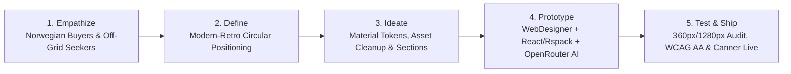
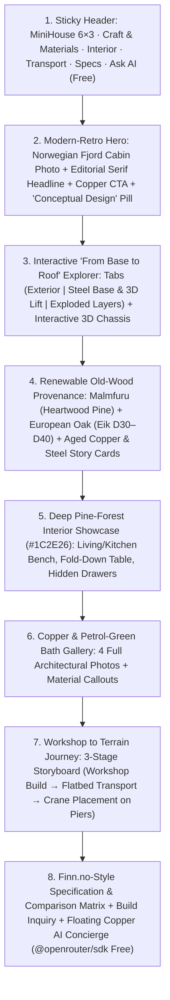

# Task Plan · MiniHouse Modern-Retro Norwegian Promotional Website (Design Thinking Process)

## Goal Description

Replace the current developer-focused front page at [https://minihouse.canner.app](https://minihouse.canner.app) (which accidentally displays the internal walkthrough mockup screenshots from `web/chat-demo/public/concepts/*.jpg` and Phase 0–4 checklists) with a **customer-facing Modern-Retro Norwegian Promotional Website** for **MiniHouse (6 × 3 m)**, structured like a high-converting Norwegian tiny-house listing (modeled on [Finn.no #417043406 — Vagabond Haven MAYA](https://www.finn.no/recommerce/forsale/item/417043406?ci=3)), while showcasing **your own MiniHouse architecture and aesthetic from `c:\Users\carlos\PROYECTOS\minihouse\images\`** instead of the MAYA trailer house.

The visual environment celebrates **renewable, chemical-free Nordic circular timber and tactile metals**:
- **Heartwood Pine (`Malmfuru`)**: Resin-dense, slow-grown heartwood traditionally used in Norwegian *stavkirker* and *laftebygg* without chemical pressure treatment.
- **European Oak (`Eik`, D30–D40)**: Heavy-duty sill beams, joinery, and moisture-critical thresholds where crushing strength and water durability are essential.
- **Aged & Brushed Copper (`Kobber`)**: Signature modern-retro Norwegian warmth (inspired by the wavy copper mirror frame, brushed copper tapware, and terracotta textiles in your bathroom photographs).
- **Petrol Green (`Petroliumsgrønn`) & Pine Forest (`Skoggrønn`)**: Rich heritage ceramic glaze and deep Nordic interior bands.
- **Anthracite Structural Steel (`Stål`)**: Precision-bolted 6000 × 3000 mm liftable base skid and corner nodes (`[CONCEPTUAL]` engineering badges preserved per [rules.md](file:///c:/Users/carlos/PROYECTOS/minihouse/rules.md)).

---

## Design Thinking 5-Stage Task Plan

---

### Stage 1 · Empathize — Understanding the Audience & Finn.no Promotional Context

**Reference Benchmark ([Finn.no #417043406](https://www.finn.no/recommerce/forsale/item/417043406?ci=3))**:
Buyers browsing *Minihus / Mikrohus* listings on Finn.no evaluate five practical questions before inquiring:
1. **Can it survive Norwegian winters & coastal weather?** (Insulation, moisture control, chemical-free durability of *Malmfuru* and *Eik*, triple glazing, wet-room standards).
2. **How does it move & install?** (Flatbed crane-liftable steel chassis vs. fragile road trailer; no permanent racking on doors/windows).
3. **How does it feel inside?** (Warmth, daylight, clever storage, real bathroom with full shower & toilet options, functional kitchen).
4. **Is it genuinely sustainable & renewable?** (Provenance of reclaimed *Malmfuru*, *Eik* sill joinery, zero toxic pressure-treated CCA/copper-salt lumber).
5. **What is included, what is conceptual vs. verified, and how do I ask questions?** (Transparent specs table + instant AI Concierge powered by `@openrouter/sdk` free models).

**Task 1.1 — Map Content & Personas**:
- Define primary buyer persona (**Norwegian cabin/backyard-unit buyer** looking for an heirloom architectural alternative to standard tiny trailers) and secondary persona (**Architect / Structural & Crane Partner** verifying transportability).
- Add a clean **NO / EN** language switch (defaulting to crisp English or Norwegian Norsk Bokmål with full translations for all promotional sections).

---

### Stage 2 · Define — Visual Identity & Modern-Retro Norwegian Material System

Instead of sterile SaaS dark-gray cards or internal engineering checklists, lock in the **Modern-Retro Norwegian Material Palette** directly derived from your 10 files in [images/](file:///c:/Users/carlos/PROYECTOS/minihouse/images):

| Material Role | Token | Hex | Reference Source in `images/` & Spec |
| --- | --- | --- | --- |
| **Kalkpuss (Warm Lime Plaster)** | `--mh-plaster` | `#F5EFE6` | [MiniHouse Nordic Meadow Homepage-1.png](file:///c:/Users/carlos/PROYECTOS/minihouse/images/MiniHouse%20Nordic%20Meadow%20Homepage-1.png) & bathroom lime walls |
| **Kalkpuss Elevated Card** | `--mh-cream` | `#FAF6EF` | [fase4/brief-web.md](file:///c:/Users/carlos/PROYECTOS/minihouse/fase4/brief-web.md) paper background |
| **Malmfuru (Heartwood Pine)** | `--mh-malmfuru` | `#B6814C` | Resin-rich aged pine vertical cladding & interior joinery |
| **Malmfuru Deep Grain** | `--mh-malmfuru-deep` | `#8A5A33` | Weathered timber detail & warm editorial sub-accents |
| **Eik (European Oak D30–D40)** | `--mh-eik` | `#6E4726` | Heavy sill beams, oak window frames ([Compact bathroom...](file:///c:/Users/carlos/PROYECTOS/minihouse/images/Compact%20bathroom%20with%20window,%20plant,%20and%20toilet-2.png)) |
| **Kobber (Brushed Copper)** | `--mh-copper` | `#B85D30` | Signature CTA buttons, active tab underlines, mirror/faucet highlights |
| **Kobber Hover / Warm Rust** | `--mh-copper-deep` | `#9A431B` | High-contrast AA copper button state (`≥ 4.5:1` with `#FAF6EF`) |
| **Skoggrønn (Pine Forest)** | `--mh-forest` | `#1C2E26` | Dark editorial interior showcase band ([MiniHouse cabin interior-1.png](file:///c:/Users/carlos/PROYECTOS/minihouse/images/MiniHouse%20cabin%20interior-1.png)) |
| **Petroliumsgrønn (Petrol Tile)** | `--mh-petrol` | `#1E5649` | Glazed ceramic shower wall accent ([MiniHouse Bathroom...](file:///c:/Users/carlos/PROYECTOS/minihouse/images/MiniHouse%20Bathroom%20with%20Petrol-Green%20Shower.png)) |
| **Stål (Structural Steel)** | `--mh-steel` | `#1E2328` | Primary typography, 6 × 3 m bolted steel chassis & roof standing seams |

**Typography (Modern-Retro Nordic Editorial)**:
- **Headings**: High-contrast editorial serif (`Fraunces` / `Georgia`, tight tracking, inspired by the headlines in `MiniHouse cabin on a Norwegian slope-2.png` and `MiniHouse cabin interior-1.png`).
- **UI & Specs**: Clean geometric grotesk (`Plus Jakarta Sans` / `Inter` / `system-ui`) + tabular monospace (`JetBrains Mono` / `ui-monospace`) for exact millimeter dimensions (`6000 × 3000 mm`) and material classes (`D30–D40`).

---

### Stage 3 · Ideate — Asset Extraction & Promotional Page Architecture

#### 3.1 Clean Asset Strategy (No Fake Browser Bars or Nested UI!)
We audited all 10 files in [images/](file:///c:/Users/carlos/PROYECTOS/minihouse/images):
- **4 Clean, Ready-to-Use Architectural Photos** (zero embedded text/UI):
  1. [MiniHouse Bathroom with Petrol-Green Shower.png](file:///c:/Users/carlos/PROYECTOS/minihouse/images/MiniHouse%20Bathroom%20with%20Petrol-Green%20Shower.png) — Petrol-green tile shower + copper mirror + reclaimed wood vanity
  2. [Reclaimed Vanity View in a MiniHouse Bathroom-1.png](file:///c:/Users/carlos/PROYECTOS/minihouse/images/Reclaimed%20Vanity%20View%20in%20a%20MiniHouse%20Bathroom-1.png) — Close-up of reclaimed Malmfuru/Eik vanity, vessel sink, brushed copper tap & wavy copper mirror
  3. [Compact bathroom with window, plant, and toilet-2.png](file:///c:/Users/carlos/PROYECTOS/minihouse/images/Compact%20bathroom%20with%20window,%20plant,%20and%20toilet-2.png) — Oak (`Eik`) window frame & daylight wet room
  4. [Shower-side view toward the timber doorway-3.png](file:///c:/Users/carlos/PROYECTOS/minihouse/images/Shower-side%20view%20toward%20the%20timber%20doorway-3.png) — Plank timber door & exposed ceiling rafters
- **6 UI-Wrapped Concept Images to Crop / Regenerate Cleanly**:
  The other 6 PNGs (`Nordic Meadow`, `Norwegian slope`, `From Base to Roof`, `cabin interior`, `From workshop to terrain`, `Movable Nordic cabin`) contain mockup headers/buttons/text. We will:
  - **Task 3.1a**: Crop clean, UI-free photo regions (where full high-res frames exist without overlapping text—e.g. the exterior cabin photo in `Norwegian slope-2`, the timber cladding close-up & steel corner joint crops at the bottom of `Nordic Meadow` and `Norwegian slope`, and the 3 interior detail crops: kitchen, bench, drawer from `cabin interior-1`).
  - **Task 3.1b**: Generate clean, borderless, UI-free 4K architectural photos matching those exact scenes (Fjord/Meadow Exterior Hero, Workshop-to-Terrain Flatbed Transport, Full Interior Living/Kitchen View, and Base-to-Roof Exploded Cutaway) so **every image on the live site is pure photography/render with zero baked-in mockup text**.
  - **Task 3.1c**: Remove the temporary `web/chat-demo/public/concepts/*.jpg` walkthrough screenshots from the production website.

#### 3.2 Promotional Page Flow (8 Curated Sections)

---

### Stage 4 · Prototype — Implementation Task Breakdown

#### Component A · Clean Visual Assets & WebDesigner Alignment
- **Task 4.1**: Run `wd_intake_project` (WebDesigner workflow) to lock design engineering & accessibility rules for the Modern-Retro Norwegian SPA.
- **Task 4.2**: Copy & optimize (WebP/JPEG) the 4 clean bathroom photos from `images/` + clean cropped detail shots + freshly generated UI-free exterior/interior/exploded/transport photos into `web/chat-demo/public/media/`. Delete `web/chat-demo/public/concepts/`.

#### Component B · Design Tokens & Typography (`web/chat-demo/src/styles/minihouse-theme.css`)
- **Task 4.3**: Create a dedicated Modern-Retro Norwegian stylesheet implementing `--mh-plaster`, `--mh-malmfuru`, `--mh-eik`, `--mh-copper`, `--mh-forest`, `--mh-petrol`, and `--mh-steel`, paired with `Fraunces` (editorial display serif) + `Plus Jakarta Sans` (body) + `JetBrains Mono` (specs/dimensions).
- **Task 4.4**: Verify WCAG AA contrast (`≥ 4.5:1` for body text, `≥ 3:1` for large headings and UI focus rings) across all combinations (especially white/cream text on `#B85D30` copper and `#1C2E26` forest green).

#### Component C · Promotional Front Page & Interactive Components (`web/chat-demo/src/components/minihouse/`)
- **Task 4.5 — `MiniHouseHero.tsx`**: Split/editorial Modern-Retro Norwegian hero featuring the Norwegian fjord cabin, copper CTA (*"Explore the 6×3 m Cabin"* + *"Ask AI About Materials & Specs"*), quick highlights (`18 m² Footprint`, `Malmfuru & Eik`, `Crane-Ready Steel Skid`), and a non-intrusive `[CONCEPTUAL]` provenance pill.
- **Task 4.6 — `BaseToRoofSection.tsx`**: Interactive **"From Base to Roof"** showcase modeled on `MiniHouse_ From Base to Roof-1.png` with copper-underlined tabs (`Exploded Layers` | `Exterior` | `Interactive 3D Steel Skid & Crane Lift`), embedding the refined `MiniHouse3DSimulator` re-styled in warm steel/copper/Malmfuru tones.
- **Task 4.7 — `MaterialsHeritageSection.tsx`**: Tactile showcase dedicated to **Heartwood Pine (`Malmfuru`)**, **European Oak (`Eik`, D30–D40)**, **Aged Copper (`Kobber`)**, and **Bolted Anthracite Steel** — including exact material descriptions, durability without toxic pressure chemicals, and crop photography.
- **Task 4.8 — `InteriorAndBathSection.tsx`**:
  - Deep pine-forest (`#1C2E26`) living/kitchen band modeled on `MiniHouse cabin interior-1.png` with 3 detail cards (*Kitchen*, *Daylight Bench*, *Hidden Oak Storage*).
  - Warm lime-plaster (`#F5EFE6`) **Copper & Petrol-Green Bath** gallery showcasing all 4 real interior photos (`MiniHouse Bathroom with Petrol-Green Shower.png`, `Reclaimed Vanity View...`, `Compact bathroom...`, `Shower-side view...`) with interactive lightbox zoom.
- **Task 4.9 — `TransportAndSpecsSection.tsx`**:
  - 3-step **"From Workshop to Terrain"** journey (`Workshop Assembly` → `Flatbed Truck` → `Crane Placement on Adjustable Piers`).
  - **Finn.no-Inspired Specification & Equipment Table** (Dimensions `6000 × 3000 mm`, Area `~18 m²`, Envelope `Malmfuru + Recycled Insulation`, Sills `European Oak D30–D40`, Chassis `S355 Bolted Steel`, Bathroom `Petrol Tile + Copper Fixtures + Composting/Cinderella/Flush Options`, Transport `Single-Piece Crane Lift`, Status `[CONCEPTUAL]` clearly noted per [rules.md](file:///c:/Users/carlos/PROYECTOS/minihouse/rules.md)).
- **Task 4.10 — `OpenRouterConciergeDrawer.tsx` & `App.tsx`**:
  - Re-skin the header and collapsible right AI drawer in Modern-Retro Norwegian Copper & Forest Green styling, pre-loaded with buyer-friendly quick prompts (*"Why Malmfuru instead of pressure-treated pine?"*, *"How is European Oak D30–D40 used in the sills?"*, *"How does crane lifting protect the glass windows?"*, *"Compare off-grid vs. standard plumbing"*), powered by `@openrouter/sdk` free models (`openrouter/free`, `deepseek/deepseek-r1:free`).
  - Keep the **Full AI Chat** and **3D Engineering Lab** accessible from a subtle secondary switcher for technical collaborators, while keeping the default landing experience 100% customer-facing promotional design.

---

### Stage 5 · Test — Quality Assurance, Accessibility & Canner Redeployment

- **Task 5.1 — Automated Build & Unit Checks**:
  - Run `pnpm lint` (`0` warnings/errors), `pnpm type`, `pnpm test` (`vitest`), and `pnpm build` (production bundle in `dist/`).
- **Task 5.2 — Responsive & Visual Audit**:
  - Inspect rendered site at **360 px (mobile)** (matching `Movable Nordic cabin concept-2.png` vertical rhythm) and **1280 px+ (desktop)** to confirm zero overlapping text, clean image aspect ratios, and keyboard focus navigation (`Tab` / `Escape` / `Enter`).
- **Task 5.3 — Git Push & Live Canner Verification**:
  - Commit and push to `https://github.com/uset82/minihouse` (`main`).
  - Trigger `canner redeploy --follow` and confirm `https://minihouse.canner.app` is live and serves the new Modern-Retro Norwegian promotional site cleanly.

---

## Open Questions for Approval

> [!NOTE]
> Please confirm before I begin executing Stage 3 & Stage 4:
> 1. **Primary Language on the Website**: Should the promotional copy default to **English** (with a **Norsk / English** toggle in the header so it works natively alongside Finn.no buyers) or **Norwegian Bokmål** by default?
> 2. **Pricing / Availability Callout**: Since the MAYA Finn.no reference shows a commercial price/order CTA, should our MiniHouse promotional page include a **"Custom Build / Project Inquiry"** CTA + indicative configuration options (off-grid solar, Cinderella/composting toilet, crane delivery) while keeping all engineering figures badged `[CONCEPTUAL]` per [rules.md](file:///c:/Users/carlos/PROYECTOS/minihouse/rules.md)?
> 3. **Clean Images Generation**: May I crop the clean photo regions from your 6 mockup PNGs and generate clean UI-free high-res versions of the exterior fjord cabin, exploded layers, living room, and workshop-to-terrain truck scenes to pair with your 4 clean bathroom photos?
